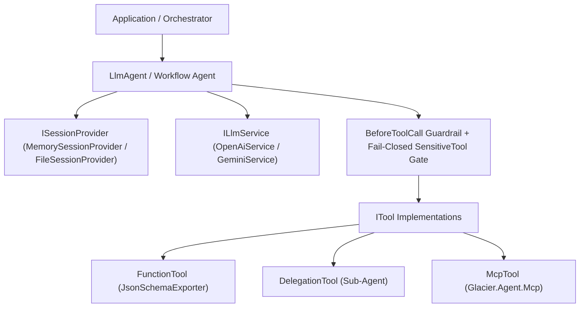

# Glacier.AgentDevKit.Adk — Architecture

`Glacier.AgentDevKit.Adk` is a 100% pure C# (.NET 10), Native AOT-compatible Agent Development Kit for building autonomous, tool-calling, multi-agent workflows backed by `Glacier.Agent` Model Context Protocol (MCP) transports.

---

## Architectural Principles

1. **Pure C# & Native AOT First (`<IsAotCompatible>true</IsAotCompatible>`):**
   - Zero Python scripts, zero unmanaged native database dependencies, and zero reflection-only runtime requirements on core execution paths.
   - Internal protocol payloads (`OpenAiService`, `GeminiService`) use `System.Text.Json.Nodes` (`JsonObject` / `JsonArray`), session persistence uses source-generated `AdkJsonContext` / `AdkIndentedJsonContext`, and `FunctionTool<TArgs, TResult>` supports source-generated `JsonTypeInfo<TArgs>` + `System.Text.Json.Schema.JsonSchemaExporter` alongside JIT convenience constructors.
2. **Real Incremental SSE Streaming & Tool-Call Reassembly:**
   - `OpenAiService.StreamGenerateContentAsync` streams Server-Sent Events (`data: ...`), yielding text deltas immediately while accumulating chunked `delta.tool_calls` fragments keyed by `index` (`id`, `function.name`, and `function.arguments` deltas) before parsing complete JSON arguments once at turn completion and correlating multi-call `tool_call_id`s.
   - `GeminiService.StreamGenerateContentAsync` streams real incremental SSE (`:streamGenerateContent?alt=sse`) with header-based authentication (`x-goog-api-key`), avoiding query-string credential exposure and full-response buffering.
3. **Fail-Closed Human-in-the-Loop (HITL) Security:**
   - Wrapping any `ITool` in `SensitiveTool` enforces a strict fail-closed gate inside `LlmAgent`: if neither `LlmAgent.ApprovalService` nor `SensitiveTool.ApprovalService` is configured—or if `ApproveAsync` returns `false`—the inner tool is **never** invoked and a structured JSON denial is returned to the model.
   - `BeforeToolCall` interceptors run prior to execution, and all error surfaces emit escaped `JsonObject` payloads.

---

## Component Overview

### Core Modules (`src/AgentDevKit.Adk/`)
- **`Abstractions.cs`**: Core contracts (`IAgent`, `ILlmService`, `ITool`, `IApprovalService`, `ISessionProvider`), `SensitiveTool`, and message/tool-call DTOs with `Id` correlation.
- **`LlmAgent.cs`**: ReAct/tool-calling loop (`RunAsync` & `RunStreamingAsync`), malformed-JSON self-correction retries (`MaxRetries`), `BeforeToolCall` guardrails, fail-closed `SensitiveTool` approval enforcement, and OpenTelemetry activity/metric instrumentation.
- **`FunctionTool.cs`**: Strongly typed synchronous and asynchronous C# tool adapter generating JSON Schema (`type`, `properties`, `[Description]`, `required`) dynamically from `TArgs` via `JsonSchemaExporter`.
- **`OpenAiService.cs` & `GeminiService.cs`**: Native AOT-safe HTTP/SSE model adapters for OpenAI-compatible endpoints (OpenAI, Ollama, vLLM, Glacier.Serve) and Google Gemini REST/SSE endpoints.
- **`SequentialAgent.cs`, `ParallelAgent.cs`, `LoopAgent.cs`, `DelegationTool.cs`**: Composable multi-agent workflow orchestrators.
- **`McpService.cs` & `McpTool.cs`**: Pure C# MCP server discovery and tool invocation powered by `Glacier.Agent.Mcp`, using trim/AOT-safe `IConfigurationSection` binding.
- **`MemorySessionProvider.cs` & `FileSessionProvider.cs`**: Thread-safe in-memory and AOT-serialized JSON file session stores.
- **`Telemetry.cs`**: `System.Diagnostics.ActivitySource` and `Meter` (`Glacier.AgentDevKit.Adk`) counters.
