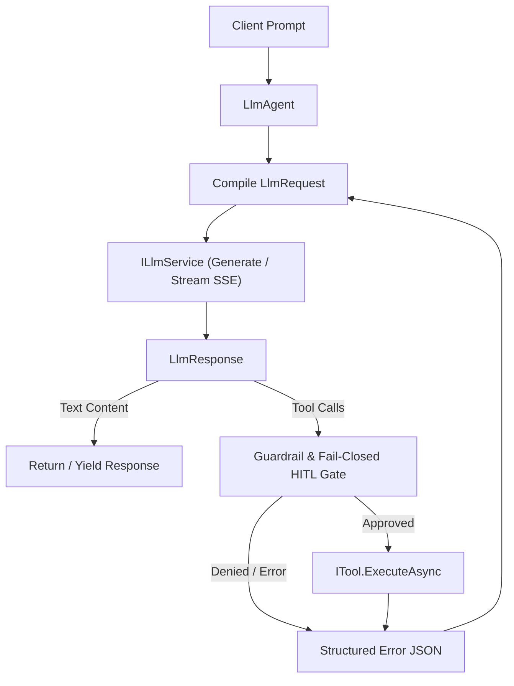

# Agent Development Kit (ADK) — Developer Manual

The **Agent Development Kit (`Glacier.AgentDevKit.Adk`)** is a pure C# (.NET 10), Native AOT-compatible library for constructing modular, resilient, and observable AI agents equipped with strongly typed tools, Model Context Protocol (MCP) integrations, multi-agent workflows, session memory providers, and fail-closed human-in-the-loop safeguards.

---

## 1. System Architecture

The core of the ADK revolves around the orchestration loop of `LlmAgent`:
- **Identity & Instructions**: System prompts defining persona, boundaries, and expected behavior.
- **Model Client (`ILlmService`)**: Pluggable adapter supporting `OpenAiService` (OpenAI, Glacier.Serve, vLLM, Ollama) and `GeminiService` (Google Gemini REST & SSE).
- **Tools (`ITool`)**: Structured actions exposed via JSON Schema (`FunctionTool<TArgs, TResult>`, `DelegationTool`, `McpTool`, `SensitiveTool`).
- **Session History (`ISessionProvider`)**: Pure C# conversation persistence via `MemorySessionProvider` or `FileSessionProvider`.



---

## 2. Core Interfaces & Tool Authoring

### `ITool` & `FunctionTool<TArgs, TResult>`
`FunctionTool<TArgs, TResult>` derives JSON Schemas automatically from `TArgs` using `System.Text.Json.Schema.JsonSchemaExporter`.

#### JIT Convenience Usage
```csharp
public sealed class CalcArgs
{
    [Description("First addend")]
    public required int A { get; set; }

    [Description("Second addend")]
    public required int B { get; set; }
}

var addTool = new FunctionTool<CalcArgs, int>(
    "add_numbers",
    "Adds two integers.",
    args => args.A + args.B
);
```

#### Native AOT Usage (`JsonTypeInfo<T>`)
```csharp
[JsonSerializable(typeof(CalcArgs))]
[JsonSerializable(typeof(int))]
internal partial class AppJsonContext : JsonSerializerContext { }

var aotTool = new FunctionTool<CalcArgs, int>(
    "add_numbers",
    "Adds two integers.",
    args => args.A + args.B,
    AppJsonContext.Default.CalcArgs,
    AppJsonContext.Default.Int32
);
```

---

## 3. Multi-Agent Orchestration Patterns

### Pattern 1: Manager-Worker Delegation (`DelegationTool`)
```csharp
var analyst = new LlmAgent("PolarisAnalyst", "gemini-2.5-flash", "Filters listings.", "Analyze pricing...", tools);
var manager = new LlmAgent("Manager", "gemini-2.5-flash", "Coordinates team.", "Delegate analysis...", new List<ITool>());

manager.Tools.Add(new DelegationTool(
    agent: analyst,
    llmService: llmService,
    name: "DelegateToPolarisAnalyst",
    description: "Filters listings by price and reviews."
));
```

### Pattern 2: `SequentialAgent`, `ParallelAgent`, and `LoopAgent`
```csharp
var pipeline = new SequentialAgent("Pipeline", "Two-stage workflow", new[] { filterAgent, summarizeAgent });
string output = await pipeline.RunAsync("Search rooms in Islington", llmService);
```

---

## 4. Security, Guardrails, and Fail-Closed HITL Approvals

### Human-in-the-Loop (`SensitiveTool` + `IApprovalService`)
`SensitiveTool` is **fail-closed**: if an agent attempts to invoke a `SensitiveTool` when no `IApprovalService` is configured on either the `LlmAgent` or the `SensitiveTool`, execution is denied automatically.

```csharp
var deleteDbTool = new SensitiveTool(new DeleteTableTool());
agent.Tools.Add(deleteDbTool);
agent.ApprovalService = new ConsoleApprovalService();
```

### Guardrail Interceptors (`BeforeToolCall`)
```csharp
agent.BeforeToolCall = (tool, args) =>
{
    if (args.Contains("..", StringComparison.Ordinal))
    {
        throw new InvalidOperationException("Directory traversal attempt blocked.");
    }
    return Task.FromResult(args);
};
```

---

## 5. Model Context Protocol (MCP) Integration

Load tools from MCP servers configured via `IConfiguration` (`McpServers` or `mcpServers` section):

```csharp
var config = new ConfigurationBuilder()
    .AddJsonFile("appsettings.template.json", optional: true)
    .AddJsonFile("appsettings.json", optional: true)
    .Build();

await using var mcpService = new McpService();
var mcpTools = await mcpService.InitializeFromConfigAsync(config);
agent.Tools.AddRange(mcpTools);
```

---

## 6. Telemetry & Observability

- **Activity Source & Meter Name**: `Glacier.AgentDevKit.Adk`
- **Trace Spans**:
  - `Run <AgentName>`
  - `Stream <AgentName>`
  - `ToolCalls <AgentName>`
  - `Invoke <ToolName>`
  - `Sequential <Name>`, `Parallel <Name>`, `Loop <Name>`
- **Metric Counters**:
  - `Glacier.AgentDevKit.Adk_tokens_total` (`tokens`)
  - `Glacier.AgentDevKit.Adk_agent_runs_total` (`runs`)
  - `Glacier.AgentDevKit.Adk_tool_executions_total` (`calls`)
