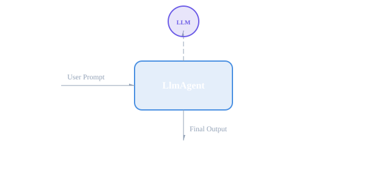
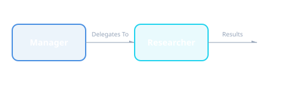
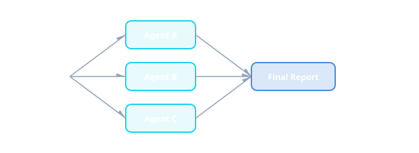
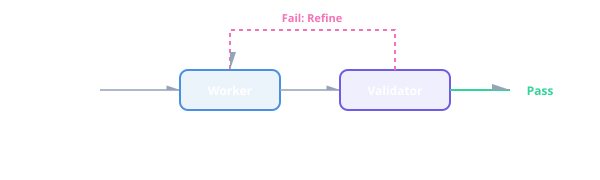
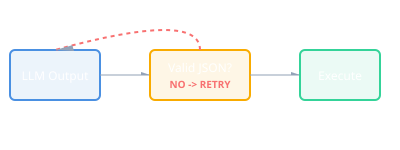

> [!IMPORTANT]
> **Repository Consolidated & Archived (2026-11):** This package has been consolidated into **[$(System.Collections.Hashtable.Target)](https://github.com/ian-cowley/Glacier.Agent)** (namespace `Glacier.Agent.Adk / Glacier.Agent.Mcp`). Please reference the `Glacier.Agent` NuGet package (v1.2.0+) for all future updates.

---
# Agent Development Kit (ADK)

[](https://dev.to/iancowley/c-got-left-behind-in-the-ai-agent-hype-so-i-fixed-it-agentdevkit-4b40)
[](https://www.nuget.org/packages/Glacier.AgentDevKit.Adk)
[](https://glaciersoftware.dev/)
[](https://buymeacoffee.com/glaciersoftware)

> 📖 **Read the Deep-Dive**: **[C# got left behind in the AI Agent hype. So I fixed it. (AgentDevKit)](https://dev.to/iancowley/c-got-left-behind-in-the-ai-agent-hype-so-i-fixed-it-agentdevkit-4b40)**

Welcome to **Glacier.AgentDevKit.Adk** — a 100% pure C# (.NET 10), Native AOT-compatible library for building autonomous AI agents that **think, plan, stream, and act** using strongly typed C# tools, multi-agent workflows, and the Model Context Protocol (MCP).

---

## Key Capabilities

- **100% Pure C# & Native AOT Compatible (`net10.0`)**: Zero Python bridges, zero native SQLite dependencies, and full `JsonTypeInfo<T>` + `JsonSchemaExporter` support.
- **Dynamic Tool Schema Generation**: `FunctionTool<TArgs, TResult>` automatically derives accurate JSON Schemas (including `[Description]` attributes and `required` properties) directly from your `TArgs` DTOs.
- **True Incremental SSE Streaming**: Real-time token streaming and multi-chunk SSE tool-call delta reassembly across both `OpenAiService` (OpenAI, Glacier.Serve, vLLM, Ollama) and `GeminiService` (`?alt=sse` with `x-goog-api-key` header auth).
- **Fail-Closed Security & Guardrails**: `SensitiveTool` enforces mandatory `IApprovalService` human-in-the-loop (HITL) consent (denying execution automatically if unconfigured), paired with `BeforeToolCall` argument interceptors.
- **Composable Multi-Agent Orchestration**: Built-in `DelegationTool`, `SequentialAgent`, `ParallelAgent`, and `LoopAgent` primitives.
- **Native OpenTelemetry**: First-class `ActivitySource` traces and `Meter` counters (`Glacier.AgentDevKit.Adk`).

---

## Getting Started



```csharp
using System.ComponentModel;
using Glacier.AgentDevKit.Adk;

// 1. Connect an LLM provider (Gemini or any OpenAI-compatible server)
var llm = new GeminiService(Environment.GetEnvironmentVariable("GEMINI_API_KEY")!);

// 2. Define a strongly typed C# tool (JSON Schema is generated automatically from WeatherArgs)
var weatherTool = new FunctionTool<WeatherArgs, string>(
    name: "get_weather",
    description: "Gets the current weather for a city.",
    execute: args => $"Sunny and 22C in {args.City} ({args.Units})"
);

// 3. Create your Agent
var agent = new LlmAgent(
    name: "TravelAssistant",
    model: "gemini-2.5-flash",
    description: "Helps travellers plan trips.",
    instruction: "You are a concise travel assistant. Use tools when needed.",
    tools: new List<ITool> { weatherTool }
);

// 4. Run or stream responses
string answer = await agent.RunAsync("What's the weather in Tokyo in metric?", llm);

public sealed class WeatherArgs
{
    [Description("City name, e.g. Tokyo")]
    public required string City { get; set; }

    [Description("Temperature unit system (metric or imperial)")]
    public string Units { get; set; } = "metric";
}
```

---

## Session Memory (`MemorySessionProvider` & `FileSessionProvider`)

Give agents persistent multi-turn memory across requests or process restarts without any native C/C++ database libraries:

```csharp
var sessions = new FileSessionProvider("./agent_sessions");

var agent = new LlmAgent(
    name: "Concierge",
    model: "gpt-4o-mini",
    description: "Remembers user preferences.",
    instruction: "Remember facts shared by the user.",
    tools: new List<ITool>(),
    sessionProvider: sessions
);

await agent.RunAsync("My favourite airline seat is aisle.", llm, sessionId: "user-42");

await foreach (var token in agent.RunStreamingAsync("Which seat should I book?", llm, sessionId: "user-42"))
{
    Console.Write(token);
}
```

---

## Multi-Agent Teams & Workflows

### Manager-Worker Delegation


```csharp
var researcher = new LlmAgent("Researcher", "gemini-2.5-flash", "Finds domain facts.", "Provide verified facts.");
var manager = new LlmAgent(
    "Manager",
    "gemini-2.5-flash",
    "Coordinates tasks.",
    "Delegate research questions to Researcher and summarize.",
    new List<ITool> { new DelegationTool(researcher, llm) }
);
```

### Orchestration Workflows
- **`SequentialAgent`**: Pipes the output of step `i` into step `i + 1`.
  
- **`ParallelAgent`**: Executes multiple specialist agents concurrently via `Task.WhenAll`, with an optional consolidator agent.
  
- **`LoopAgent`**: Iteratively refines output until a `stopCondition` predicate succeeds or `maxTurns` is reached.
  

---

## Model Context Protocol (MCP)

Discover and invoke external MCP servers natively via `Glacier.Agent.Mcp`:

```csharp
await using var mcp = new McpService();
var mcpTools = await mcp.InitializeFromConfigAsync(configuration);
agent.Tools.AddRange(mcpTools);
```

---

## Security: Guardrails & Fail-Closed HITL Approvals

Wrapping a tool in `SensitiveTool` guarantees **fail-closed** enforcement: if `ApprovalService` is missing or returns `false`, execution is blocked before the tool can run.

```csharp
var deleteTool = new SensitiveTool(new DeleteDatabaseTool());

var agent = new LlmAgent("OpsAgent", "gpt-4o-mini", "Ops assistant", "Manage databases safely.", new List<ITool> { deleteTool })
{
    ApprovalService = new ConsoleApprovalService(),
    BeforeToolCall = (tool, argsJson) =>
    {
        if (argsJson.Contains("..", StringComparison.Ordinal))
        {
            throw new InvalidOperationException("Path traversal blocked.");
        }
        return Task.FromResult(argsJson);
    }
};
```

---

## Resilience & Self-Correction



When local or quantized models emit noisy JSON around tool arguments, `OpenAiService` extracts valid JSON blocks and `LlmAgent` feeds validation errors back to the model for automatic self-correction up to `MaxRetries`.

---

## What's New in v1.1.0

- **Dynamic JSON Schema Generation (`FunctionTool`)**: Replaced static placeholder schemas with `.NET 10` `JsonSchemaExporter` (`[Description]`, `required`, and Native AOT `JsonTypeInfo<T>` overloads).
- **Streaming SSE Tool-Call Reassembly & True Gemini SSE**: `OpenAiService` reassembles chunked SSE `delta.tool_calls` fragments and correlates `tool_call_id`s; `GeminiService` streams real incremental SSE (`?alt=sse` + `x-goog-api-key` header).
- **Fail-Closed `SensitiveTool` Enforcement**: `LlmAgent` strictly blocks `SensitiveTool` execution whenever no `IApprovalService` is configured.
- **Full Native AOT Compatibility (`<IsAotCompatible>true</IsAotCompatible>`)**: Source-generated `AdkJsonContext`, AOT-safe MCP configuration binding, and zero build/trim warnings under `<TreatWarningsAsErrors>true</TreatWarningsAsErrors>`.

---

## Credits

Developed by **Ian Cowley** and **Antigravity** (Google DeepMind).

---

## ❄️ Glacier Ecosystem & Support

Part of the **[Glacier Ecosystem](https://glaciersoftware.dev/)** — high-performance, zero-allocation developer tooling and data engines natively built for modern C# and .NET 10.

* 🌐 **Website & Documentation**: [glaciersoftware.dev](https://glaciersoftware.dev/)
* ☕ **Buy Me a Coffee**: [buymeacoffee.com/glaciersoftware](https://buymeacoffee.com/glaciersoftware)
* ❤️ **GitHub Sponsors**: [github.com/sponsors/ian-cowley](https://github.com/sponsors/ian-cowley)
* 🐙 **All Repositories**: [github.com/ian-cowley](https://github.com/ian-cowley)

